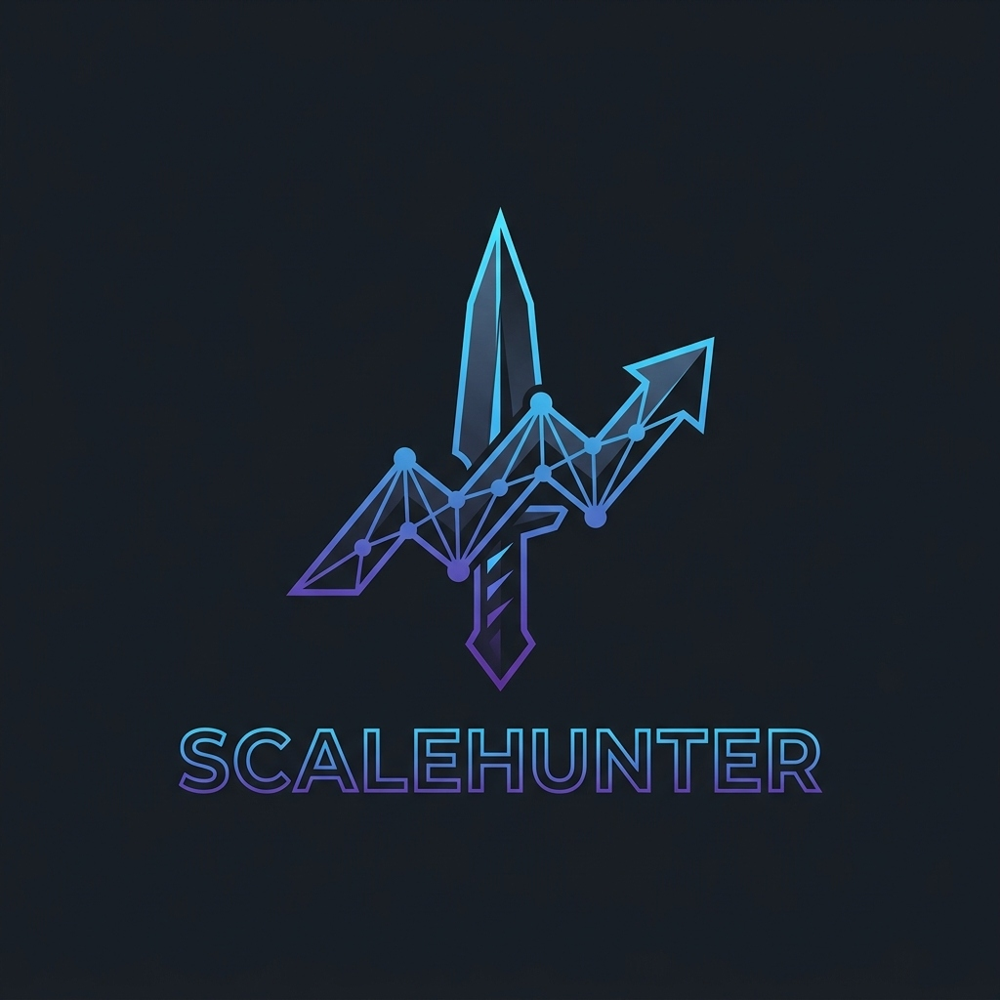

<div align="center">
  
  <h1>Scale Hunter</h1>
  <p><strong>A Gamified System Design & Software Architecture Platform</strong></p>
  
  [](https://reactjs.org/)
  [](https://nextjs.org/)
  [](https://tailwindcss.com/)
  [](#)
</div>

---

## ✨ Vision
System Design preparation is notoriously dry, theoretical, and difficult to evaluate without a senior engineer present. **Scale Hunter** solves this by gamifying the learning process. Inspired by the "Solo Leveling" universe, it immerses software engineers in a tactical HUD where complex scalability challenges are treated as "Dungeons." Users architect systems, submit their designs, and receive instant, AI-driven feedback to "Level Up" their engineering rank.

## 🏗️ Technical Architecture

This application is built with a focus on high performance, strict type safety, and robust state management.

- **Framework**: Next.js (App Router)
- **Library**: React 18
- **Styling**: Tailwind CSS v4 (Custom Design Tokens)
- **State Management**: React Context API (`HunterContext`, `DailyDungeonsContext`, `DailyQuestsContext`)
- **Persistence**: Custom `useLocalStorage` hooks bridging CSR and SSR seamlessly.
- **Hydration Strategy**: Custom `<Skeleton />` components and `isMounted` checks to prevent React hydration flashes during local storage initialization.

## 🎨 Design System: "Kinetic Sovereignty"
This project does not use generic UI libraries. It relies on a custom, strict design system dubbed **"Kinetic Sovereignty"** to achieve an aggressive, tactical aesthetic.
*   **0px Radius Rule:** Sharp edges only. Curves represent weakness.
*   **Tonal Layering:** 1px divider lines are strictly forbidden. Layout depth is achieved through a specific hierarchy of `surface`, `surface-container`, and `surface-bright` tokens.
*   **Mana Pulses:** Heavy reliance on custom `box-shadow` glows (`tertiary` and `primary`) for hover states, avoiding cheap background color shifts.
*   **Typography:** *Space Grotesk* for aggressive Display headers, *Inter* for dense stat legibility.

## 🗺️ Engineering Roadmap

### ✅ Phase 1: Frontend Architecture (Completed)
- [x] Design and implement the "Kinetic Sovereignty" Tailwind CSS framework.
- [x] Construct global routing layout (`/`, `/profile`, `/dungeon`, `/quests`, `/leaderboard`).
- [x] Implement Context API to eliminate prop-drilling for Hunter stats, Quests, and Dungeon states.
- [x] Integrate custom `useLocalStorage` hooks for persistent user progression.
- [x] Resolve SSR/Client hydration mismatches using dynamic loading Skeletons.
- [x] Implement dynamic array filtering and shuffling logic for Rank-based Dungeon generation.

### ⏳ Phase 2: The API & AI Brain (Next)
- [ ] Initialize an Express.js / Node.js backend architecture.
- [ ] Implement robust RESTful API routing controllers.
- [ ] Integrate an LLM provider to ingest user System Design answers and dynamically calculate XP, pass/fail status, and return structured JSON feedback.

### 📅 Phase 3: Data Persistence Layer
- [ ] Provision and deploy a PostgreSQL database.
- [ ] Design relational schemas for `Users`, `Dungeons`, `Quests`, and `Evaluations`.
- [ ] Connect the backend to the database using an ORM to permanently persist Hunter rankings.

### 📅 Phase 4: Full-Stack SSR Optimization
- [ ] Refactor CSR (Client-Side Rendered) data fetching to Next.js Server Components.
- [ ] Implement Server Actions for form submissions and user progression.
- [ ] Finalize application deployment and Vercel edge caching.

---

## 🚀 Running Locally

Clone the repository and install dependencies:

```bash
git clone https://github.com/yourusername/scale-hunter.git
cd scale-hunter/solo-leveling
npm install
npm run dev
```

Open [http://localhost:3000](http://localhost:3000) with your browser to see the result.
